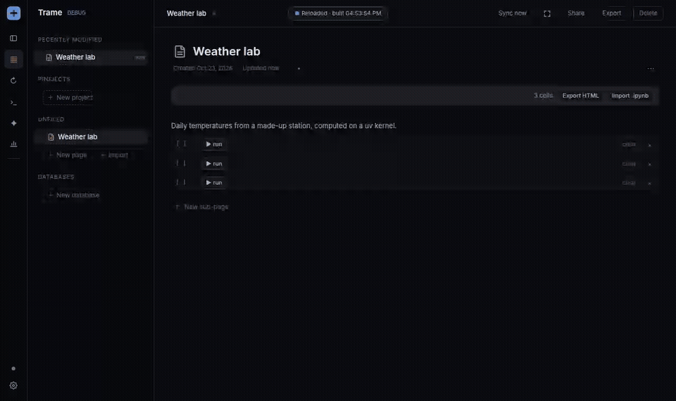

# trame-notebook-cells

A notebook plugin for [Trame](https://github.com/Andarius/trame): pages hold Python code cells that run on a Jupyter kernel.



- **Cells**: a CodeMirror editor, SQL highlighted inside Python strings, an optional import of your PyCharm keymap, and Jupyter command mode (Esc, a/b, dd, j/k, Enter, ⇧⏎, Ctrl+⏎, ii). Outputs are stored in nbformat shapes, so cells convert to and from `.ipynb`.
- **Kernel bar** (sticky): kernel picker, Run all / Stop, Restart, Clear outputs, Export HTML, Import .ipynb.
- **Project kernels**: a wizard that writes a kernel spec running `uv run --directory <folder> [--python X] --with ipykernel --with …`. It reads the folder's `pyproject.toml`, lists the Pythons uv knows about and fetches package versions from PyPI.

## Use

In a Trame checkout, list this repo's path relative to it (here `~/Projects/trame-notebook-cells` next to `~/Projects/trame`), then build Trame with the plugin compiled in:

```bash
echo '{ "plugins": ["../trame-notebook-cells"] }' > plugins.local.json
just plugins   # composes src/mod.rs into trame-local and web/ into the plugins bundle
just dev       # or rebuild and restart your Trame build
```

Start a Jupyter server yourself (`jupyter lab --no-browser`), enable the plugin under Plugins and paste the server's URL and token. "/code" in a page adds a cell. While the plugin is off, cells keep showing their source and outputs.

The backend talks to that Jupyter server (REST and kernel WebSockets) and to PyPI when the wizard looks up a package. Project kernels write kernel specs under `~/.local/share/jupyter/kernels/trame-<name>`, so they need the Jupyter server on the same machine. The PyCharm import reads your IDE's keymap files and never writes them. Cells are page blocks: they sync like the rest of the page.

`src/mod.rs` is the backend, a native Rust module compiled into `trame-local` (it reaches Trame only through `crate::plugins::api`); `web/index.ts` is the frontend (via `@trame/web-api`). CodeMirror and Lezer come from Trame's `app/web/package.json`.

## Test

From the Trame checkout, with the plugin composed:

```bash
cargo clippy -p trame-local --all-targets --locked -- -D warnings
cargo test -p trame-local --locked --lib local_gen::   # settings, uv and PyPI parsing, the PyCharm keymap
(cd app/web && npm run typecheck)
```

In this repo, `bun test` runs the import boundary check and the version check.

## Release

Bump `VERSION` in `version.ts` and `src/mod.rs`, merge, then push a matching tag (`git tag v0.2.0 && git push origin v0.2.0`). The release workflow refuses a tag that differs from `VERSION` and publishes a GitHub release with generated notes; Trame then shows "Update available" for older installs.
